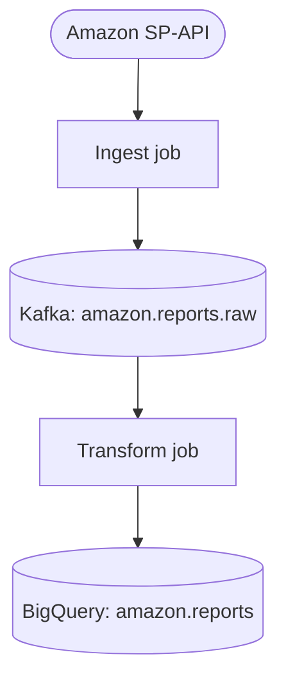

# README Writer

This skill produces and maintains project READMEs that are useful to a junior engineer arriving cold. The goal is not a comprehensive manual — it's the smallest document that lets a new engineer **understand**, **run**, and **change** the project safely.

## Operating modes

Pick the mode based on what you find in the repo root:

| Mode | When | What you do |
| --- | --- | --- |
| **Create** | No `README.md` exists, or the file is essentially empty (≤ ~5 substantive lines) | Generate a full README using the canonical structure below |
| **Audit-and-patch** | A `README.md` exists with real content | Read it, survey the repo, identify gaps and staleness, apply **minimal targeted edits**. Do NOT rewrite from scratch |

Audit-and-patch is the default. Junior engineers benefit more from an accurate README than a beautiful one, and rewriting destroys hard-won institutional voice (warnings, gotchas, oncall notes) that the existing authors put there for a reason.

## The repo survey

Before writing or editing anything, look at what's actually in the repo. Junior-friendly docs are grounded in what the project really does, not what the previous README claimed it does. Batch these reads in a single tool turn — multiple `Read`, `Glob`, and `Grep` calls in one message. They're independent and serial reads waste time:

1. **Entry points and runtime** — `pyproject.toml`, `setup.py`, `package.json`, `go.mod`, `Cargo.toml`, `Dockerfile`, `Makefile`, top-level `main.py` / `cmd/` / `bin/`. These tell you the language, how it's invoked, and what depends on what.
2. **Configuration surface** — `.env.example`, `config/`, `settings.py`, `values.yaml`. Lists the env vars a new engineer needs to set.
3. **Deployment and ops** — `.github/workflows/`, `helm/`, `terraform/`, `k8s/`, `cronjobs/`, `Dockerfile`. Tells you where it runs and how it gets there.
4. **Tests and tooling** — `tests/`, `pytest.ini`, `tox.ini`, `pre-commit-config.yaml`, `Makefile` targets. Tells you what "all green" looks like locally.
5. **Existing docs** — `README.md`, `CLAUDE.md`, `AGENTS.md`, `docs/`. Voice, terminology, and any warnings worth preserving.

Resist the urge to read every source file. The survey above is enough to write an accurate orienting README; deep reading belongs in the design doc, not the README.

## Canonical structure

Every README this skill produces uses these sections, in this order. In audit mode, add missing sections in this order but do not reorder existing sections that already work.

```markdown
# <Project Name>

<One-sentence "what this is and who it's for.">

## Overview
<2–4 sentences: what it does, why it exists, what it talks to. Name the upstream/downstream systems by name. Avoid marketing language.>

## Architecture
<A mermaid flowchart showing the dominant process or data flow. See "Mermaid conventions" below. If the project has no meaningful runtime flow (a library, shared schema package, dotfiles, static config repo), replace this with a **Where this fits** section — a small diagram or paragraph showing what consumes the project, not what it does internally.>

## Getting Started
<Numbered steps to go from `git clone` to a working local run. A junior engineer should succeed by copy-pasting these. Prefer expansive steps (full `.env` templates with placeholder values, full command lines including flags) over terse references like "set up your env" — the goal is copy-paste success, not brevity. If there is no local-run path (Terraform modules, Helm charts, Airflow DAG repos, shared libraries), replace this with a **How to use** section — a minimal install/import example, a `terraform apply` invocation from a consumer module, or instructions for invoking the DAG locally.>

## Configuration
<Whatever knobs a new engineer needs to set — env vars, YAML config keys, CLI flags, Helm `values.yaml` overrides, secret references. Use a table: name, what it's for, where the value comes from in each environment (local / staging / prod), example. Mark secrets clearly and never paste real values.>

## Project Layout
<Short bullet list of the files and directories that matter, one line each. Skip directories whose purpose is obvious from the name (`tests/`, `.github/`). If a single config file is the **source of truth** for what the project does — which jobs deploy, which tables export, which DAGs are scheduled (typically `.gitlab-ci.yml`, a top-level `dags.yaml`, `terragrunt.hcl`, or a registry dict in code) — call it out by name and say so explicitly. A junior engineer needs to know where to look first.>

## Operations
<How it gets deployed, where it runs, where logs and metrics live, and who owns it. Default the owner to **the data engineering team** unless `CODEOWNERS`, a Helm chart annotation, or `CLAUDE.md` says otherwise. If there is an oncall runbook elsewhere, link to it rather than duplicate.>

## Conventions
<Non-obvious project-specific rules: branch strategy, commit style, test layout, lint config, any "we always do X here" rules that would surprise an outsider.>
```

Omit a section only if it would be empty or actively misleading. An empty section is worse than no section — it implies the project has nothing worth saying there.

**Add a repo-specific section** when there is a primary form-of-change that doesn't fit cleanly into one of the canonical sections — typically "Adding a new X" where X is whatever this repo exists to make easy to add (a new exported table, a new connector, a new DAG, a new tenant). Place it between **Project Layout** and **Operations**. Junior engineers usually arrive at a repo with a specific change to make, not abstract curiosity — a how-to-extend section earns its place when the repo has a clear "add one of these" pattern.

## Mermaid conventions

Process and data flow always render as a `mermaid` flowchart. No sequence diagrams, ER diagrams, or state diagrams in this skill — flowcharts cover 90% of what a junior engineer needs to grok a system, and using one diagram type consistently makes them easier to read across repos.

Rules:

- Use `graph TD` (top-down) for pipelines and request flows. Use `graph LR` (left-right) only when the flow is genuinely linear and TD would produce an awkward tall diagram.
- Node labels are short noun phrases or imperative verbs: `Kafka: orders`, `Ingest job`, `Write to BigQuery`. Not full sentences.
- Use **semantic node IDs** (`sp_api`, `ingest_job`, `topic_raw`, `bq_reports`) rather than letters (`A`, `B`, `C`). The mermaid source is what shows up in PR diffs and `git blame`, so readable IDs make the diagram reviewable without rendering it.
- Distinguish what runs from where data lives from what we call out to. Use three shapes consistently:
  - **Rectangles** `[ ]` for code we run (jobs, services, transforms)
  - **Cylinders** `[( )]` for anywhere data lives (warehouses, buckets, Kafka topics, queues, tables)
  - **Stadiums** `([ ])` for external APIs we call (someone else's HTTP endpoint, third-party SaaS)
- One diagram per README. If the project has multiple distinct flows (e.g. ingest vs. backfill), it's usually a sign one of them belongs in a sub-doc. Put the dominant flow in the README and link out for the rest.
- Keep it under ~12 nodes. If it doesn't fit, you're documenting too much detail — the README is an orienting document, not a design doc.

Example shape (do not copy verbatim — match the actual repo):

````markdown

````

## The audit process (audit-and-patch mode)

Walk the existing README section by section and answer:

1. **Is it still true?** Cross-check every concrete claim against the repo survey: file paths, command examples, env var names, deployment targets, version numbers, dependency names. Things that drift fast.
2. **Is it missing?** Compare against the canonical structure. Are there present-in-repo things with no README entry? (A `Dockerfile` but no Operations section. A `.env.example` but no Configuration table. A new entrypoint that getting-started doesn't mention.)
3. **Is the architecture diagram still accurate?** If the flow changed — new sink, new source, renamed component — update the mermaid. If there isn't one, add one.
4. **Is anything actively misleading?** Outdated warnings, references to systems we no longer use, commands that no longer work. These are worse than missing content because a junior engineer will trust and follow them.

Then make the smallest set of edits that fixes the issues found. Prefer `Edit` over `Write`. Preserve the existing voice, terminology, and any project-specific warnings — the previous authors put them there on purpose.

## Style

- Write for an engineer who is competent but new to **this specific repo**. Assume general programming literacy; do not assume domain knowledge or familiarity with the project's history.
- Short sentences. Concrete nouns. Name systems explicitly (`BigQuery`, `Kafka`, `Sweetwater Helix API`) rather than vague labels (`the warehouse`, `the queue`, `the upstream API`).
- Use fenced code blocks for every command a reader is meant to copy. Do not put commands inline.
- Use relative links (`./docs/runbook.md`) for in-repo references and full URLs for everything else.
- **Surface upstream-system URLs** if the repo's source or config files contain them — Airtable bases, Looker dashboards, Confluence pages, Linear projects, Grafana boards. Pull them into the README near where they're relevant. A new engineer should not have to grep `.gitlab-ci.yml` to find the Airtable base their job populates.
- Don't include CI badges, contributor lists, license boilerplate, or screenshots unless the user asks. They bloat the file and rarely earn their keep on internal repos.
- Don't add emojis unless the user already uses them in the existing README.

## Anti-patterns

- **Don't summarize the source code.** A list of every module and what it does is reference material, not orientation. Mention only directories a new engineer needs to know to find their way around.
- **Don't speculate.** If the repo survey doesn't show you something (e.g. who owns this service, what the SLO is), either ask the user or leave it out. Inventing plausible-sounding facts is worse than omitting them.
- **Don't aspirational-document.** The README describes the project as it is today, not as it should be. Planned features belong in tickets or design docs.
- **Don't rewrite to match the template.** If the existing README has sections in a different order and they read well, leave them alone. The template is for *missing* sections, not enforcement.
- **Don't duplicate the runbook.** If oncall docs, design docs, or ADRs exist elsewhere, link to them. The README is the index, not the encyclopedia.

## When you're not sure

If the repo is unfamiliar enough that you can't confidently fill a section, ask **before** writing — one or two targeted questions, not a questionnaire. Good things to ask when the repo doesn't tell you:

- **Deployment target** — where does this actually run? (Cloud Run, GKE, Airflow, BigQuery scheduled query, locally only)
- **Trigger** — what kicks it off? (cron schedule, Kafka event, HTTP request, manual `make run`)
- **Upstream / downstream systems** — the real names of what it reads from and writes to, since vague labels defeat the purpose of the README
- **Owner** — only if the default ("data engineering team") feels wrong for this repo and there's no `CODEOWNERS` / `CLAUDE.md` signal

A README built on guesses is the failure mode this skill exists to prevent.
